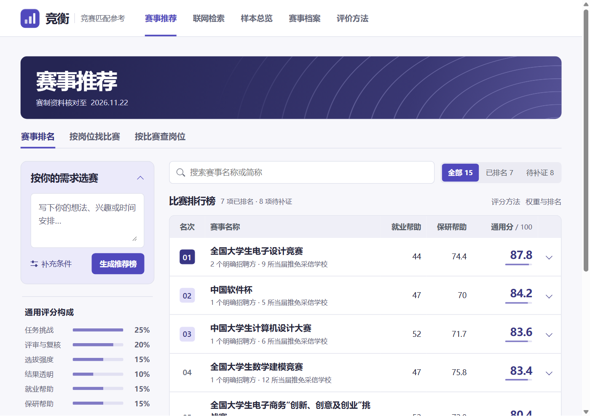
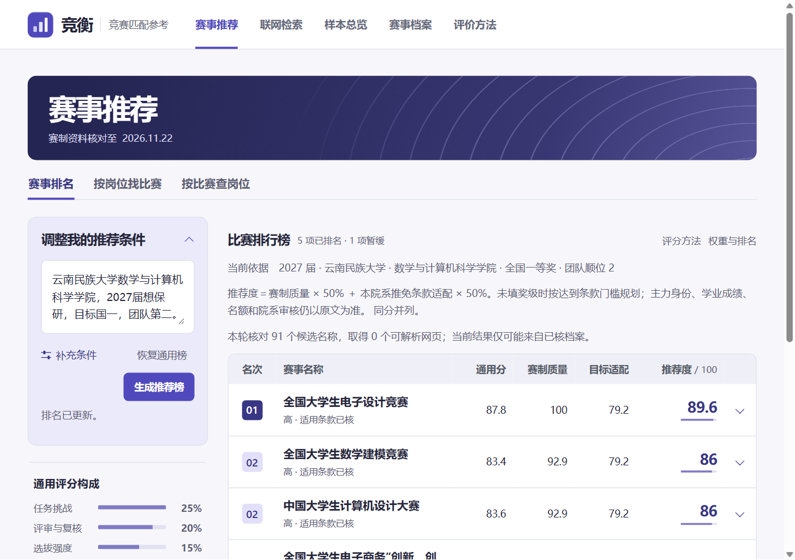
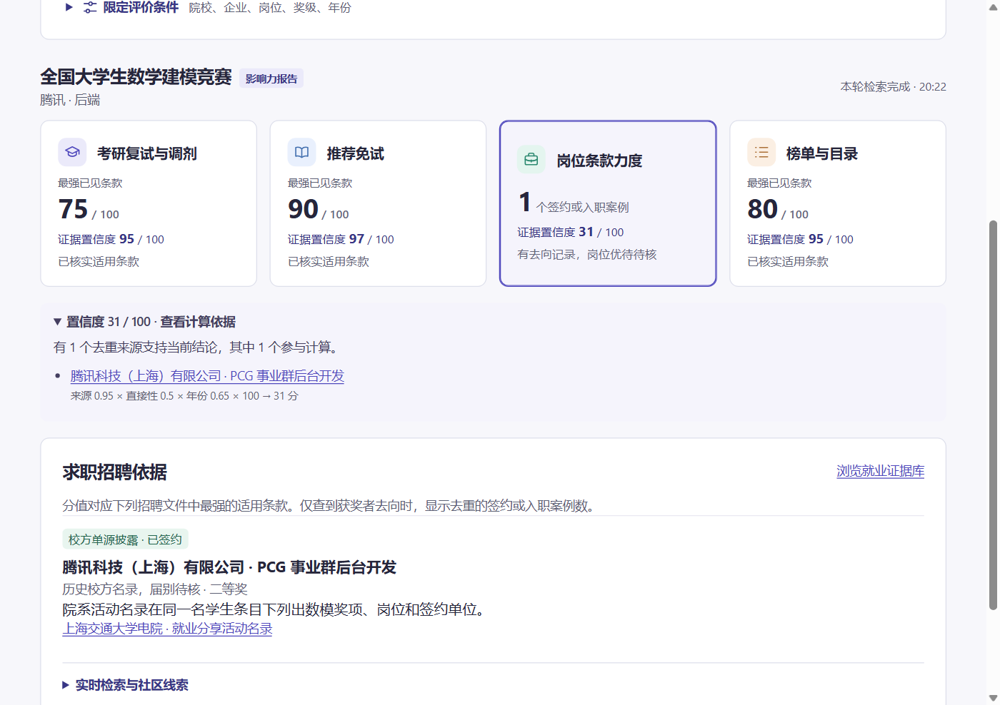

# 【StudyHack】竞衡｜同一场比赛，对想保研和想求职的人各有什么用？

[打开竞衡，试试我的参赛条件](https://jingheng-competition-bq0b0ls7rt0.qoder.zone/)

> 2026 Qoder 高校创造力大赛 · StudyHack 学习科研  
> 参赛队伍：竞衡团队　｜　Qoder CN 账号：Arisu1

## 我是谁，为什么做竞衡

我是竞衡团队的参赛者，负责选赛需求、评分规则和实测。做竞衡的起点是一个很具体的问题：暑假只够准备一场比赛，室友想走推免，我想找后端实习，我们该照着同一张榜报名吗？

查资料时，我碰到一条很容易读错的记录：一位数模获奖同学后来签约了腾讯。顺着高校原文能找到他的岗位，可要回答「投这个岗位，数模奖能不能加分」，还得找到招聘方写下的条件。我想让同学在报名之前，就能看清每份材料究竟支持哪一步判断。

## 作品是什么

竞衡把赛事本身的评分和个人推荐放在同一张榜里。首页收录 15 项赛事，其中 7 项有通用分，另外 8 项仍待补证。展开一行，可以逐项查看任务挑战、评审与复核、选拔强度、结果透明、就业帮助和保研帮助。

**图 1 · 第一次打开竞衡。** 电赛的通用分是 **87.8**，数模是 **83.4**。左侧可以写下自己的需求。

## 怎么用：从一场比赛追到一条证据

**第一步，先看通用榜。** 打开「赛事推荐」，展开「全国大学生电子设计竞赛」，看六项得分和依据。只想浏览的同学，在这一步就能比较几场比赛。

**第二步，用自己的条件重排。** 在「按你的需求选赛」输入下面这句话，点「生成推荐榜」。

> 云南民族大学数学与计算机科学学院，2027 届想保研，目标国一，团队第二。

**图 2 · 同一场电赛，多出一个属于这位同学的分数。** 这一行同时显示通用分 **87.8** 和个人推荐度 **89.6**。其中赛制质量为 100，院系条款适配为 79.2，本次各占一半。

**第三步，只改一个条件。** 在「补充条件」里把团队署名顺位改为 1，重新生成。电赛的个人推荐度从 **89.6** 变成 **96.0**。准备组队时，可以直接展开院系原文，看看署名顺位对自己意味着什么。

**第四步，换到求职场景。** 在「联网检索」里查「全国大学生数学建模竞赛」，招聘单位填「腾讯」，目标岗位填「后端」。点「联网评估」，展开置信度的计算依据。

**图 3 · 一条签约记录能说明多少？** 这里找到 **1 个签约或入职案例**。页面把置信度拆开给你看：高校来源 0.95 × 案例直接性 0.50 × 年份待核 0.65 × 100，四舍五入为 **31/100**。图下方可以打开上海交通大学电院的原文。

**第五步，查一下这个结论的边界。** 保留公司和比赛，把岗位改成「视觉设计」。这次得到 **0 条适用证据**。前面的 31 分描述的是已有材料对后端案例的支持程度，录用概率需要另外的申请与录用数据。

## 我怎么用 Qoder

我先让 Qoder 用模拟赛事试算，再拿数模国赛的公开资料检查获奖率。遇到校内战报把国奖、省奖合并统计时，我们给评分规则加了三个核对项：哪一届、哪一级奖、分母是哪批参赛队。Qoder 在 9 项赛事的研究原型中实现了检索与评分流程，接入招聘和推免材料，也修复了从榜单选中赛事后，查询表单没有同步的问题。

我把此前在 Qoder 之外开发的 15 项赛事网页导入 Qoder CN。为了让评委打开链接就能查榜和生成个人推荐，Qoder 将默认榜单、个人推荐和联网检索的请求接到 Qoder Sites 的服务端函数，随后构建并发布了这个版本。

文中三张图取自参赛部署版本在本机运行的实际界面。11 月 24 日，我另用未登录请求复测了公开站点：15 项赛事的排序和分值与原版一致，署名顺位、单场时长、岗位和社区自述在内的 **7 组查询全部通过**。

